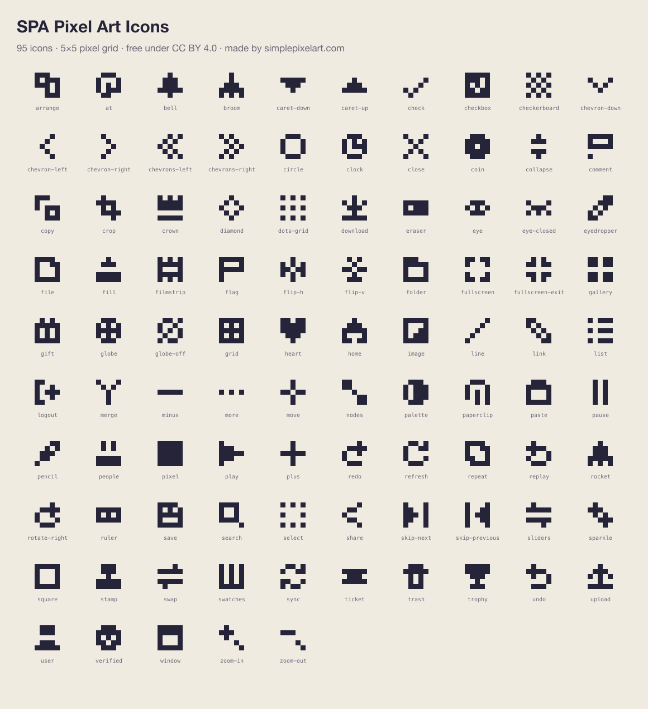

# SPA Pixel Art Icons

95 pixel art icons on a strict **5×5 grid** — one colour, square pixels, no curves.
Made by [SimplePixelArt](https://simplepixelart.com) for its free online pixel art editor.



## What's inside

- `svg/` — 95 SVG icons, `viewBox="0 0 15 15"` (1 pixel = 3 units), `fill="currentColor"`
- `png/15`, `png/30`, `png/60`, `png/120` — black PNGs at 1×, 2×, 4×, 8×
- `icons.json` — every icon's SVG path (`d`, 15×15 viewBox) by name, for drawing them in code

## Use them crisp

Each icon is 5 pixels wide. Render at a multiple of 5 px (15, 20, 25, 30…) so every pixel lands on whole screen pixels.

```html

```

```css
.icon { width: 20px; height: 20px; background: currentColor;
        -webkit-mask: url(svg/pencil.svg) no-repeat center / contain;
                mask: url(svg/pencil.svg) no-repeat center / contain; }
```

Scaling PNGs? Use nearest-neighbour (`image-rendering: pixelated`).

## License

[CC BY 4.0](LICENSE) — free for personal and commercial use, modify as you like.
Please credit: **"Icons by SimplePixelArt — https://simplepixelart.com"**.

## Icons

arrange · at · bell · broom · caret-down · caret-up · check · checkbox · checkerboard · chevron-down · chevron-left · chevron-right · chevrons-left · chevrons-right · circle · clock · close · coin · collapse · comment · contrast · copy · crop · crown · diamond · dots-grid · download · eraser · eye · eye-closed · eyedropper · file · fill · filmstrip · flag · flip-h · flip-v · folder · fullscreen · fullscreen-exit · gallery · gift · globe · globe-off · grid · heart · home · image · line · link · list · logout · merge · minus · more · move · nodes · paperclip · paste · pause · pencil · people · pixel · play · plus · redo · refresh · repeat · replay · rocket · rotate-right · ruler · save · search · select · share · skip-next · skip-previous · sliders · sparkle · square · stamp · swap · swatches · sync · ticket · trash · trophy · undo · upload · user · verified · window · zoom-in · zoom-out

Make your own pixel art icons in the browser: https://simplepixelart.com/editor
